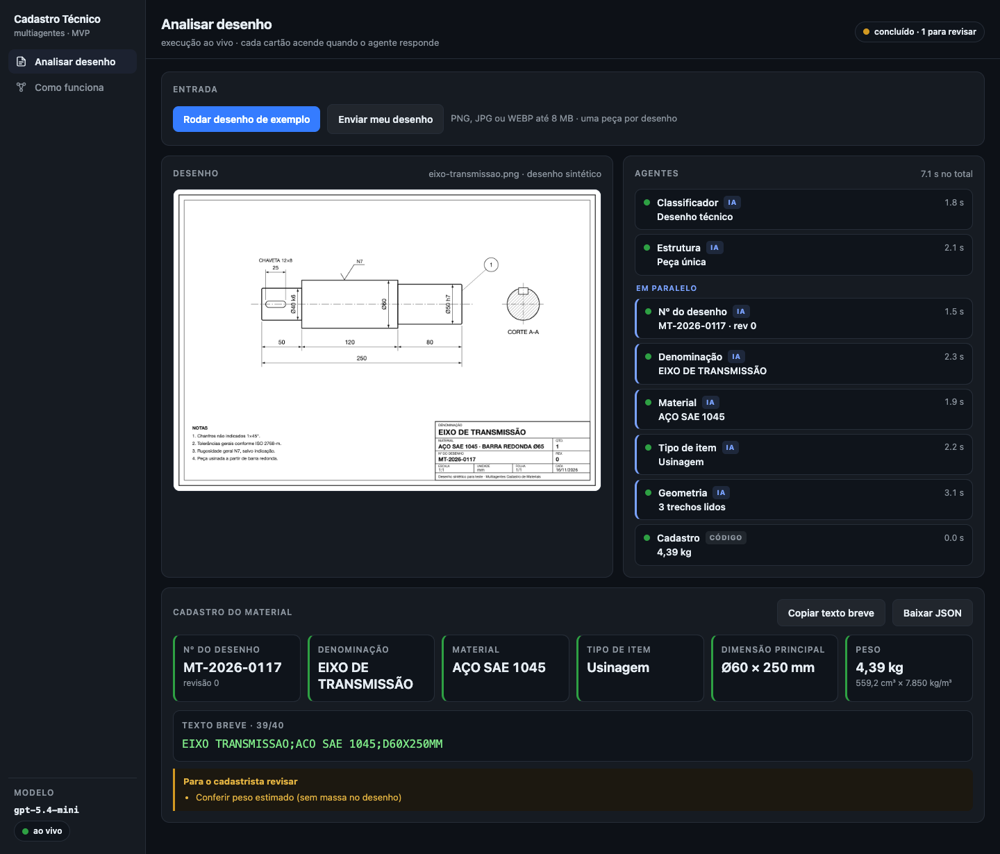

# Multiagentes · Cadastro Técnico de Materiais

**MVP funcional**: agentes de IA leem um desenho técnico e devolvem o cadastro do material pronto para revisão: número do desenho, denominação, material, tipo de item, dimensão principal, peso e texto breve padronizado.

A ideia vem de 13 anos trabalhando com dados mestres de materiais (SAP/MDM): boa parte do cadastro técnico é alguém lendo o carimbo e as cotas de um desenho e digitando em um sistema. Aqui, cada atributo tem um agente especialista, e o que é conta fica com o código.



## O caminho do MVP

Como é um MVP, existe **um único caminho**: desenho técnico de **uma peça** em imagem (PNG, JPG ou WEBP).

```
desenho ─► Classificador ─► Estrutura ─► ┌ Nº do desenho ┐
            (é desenho?)   (peça única?)  │ Denominação   │
                                          │ Material      │ ─► Cadastro (sem IA)
                                          │ Tipo de item  │    peso, texto breve, pendências
                                          └ Geometria     ┘
                                         5 agentes em paralelo
```

| Agente | Arquivo | Devolve |
|---|---|---|
| Classificador | `backend/classifier.py` | desenho técnico, catálogo ou outro |
| Estrutura | `agent_drawing/agent_drawing_structure.py` | peça única ou conjunto |
| Nº do desenho | `agent_drawing/agent_drawing_number.py` | código e revisão do carimbo |
| Denominação | `agent_drawing/agent_drawing_name.py` | nome da peça |
| Material | `agent_drawing/agent_drawing_material.py` | especificação e família (para a densidade) |
| Tipo de item | `agent_drawing/agent_drawing_tipo_item.py` | usinagem, caldeiraria, fundido, não metálico… |
| Geometria | `agent_drawing/agent_drawing_weight.py` | trechos com as cotas lidas (ou a massa declarada) |
| Cadastro | `backend/cadastro.py` | **código, sem IA**: volume × densidade, texto breve de 40 caracteres e pendências |

Catálogos e conjuntos são reconhecidos pelos dois primeiros agentes e devolvidos como **fora do escopo**, sem gastar as outras chamadas.

## Decisões

- **A IA lê, o código calcula.** O agente de geometria só transcreve as cotas (`"Ø40 k6 · 50"` → 40 mm × 50 mm). Volume e peso são calculados em Python. Na primeira versão o modelo leu Ø40 como Ø46; pedir que ele copie a cota antes de converter resolveu (4 de 4 leituras corretas).
- **Saída validada.** Cada agente devolve um modelo Pydantic via Structured Outputs da OpenAI. Campo ilegível vira `null` e aparece como pendência, nunca como chute.
- **Um agente por atributo.** Instruções curtas e específicas, fáceis de testar e de trocar uma a uma. Os cinco agentes de atributo rodam em paralelo (~7 s no total).
- **Falha isolada.** Se um agente falha, o campo dele vai para revisão e o resto do cadastro continua valendo.
- **Revisão humana no fim.** O resultado é uma proposta de cadastro com lista de pendências, não um material criado automaticamente.

## O caso de teste

`data/exemplo/eixo-transmissao.png` é um desenho **sintético**, feito para este projeto (fonte em SVG ao lado), com valores conhecidos:

| Campo | Esperado |
|---|---|
| Nº do desenho | MT-2026-0117, revisão 0 |
| Denominação | EIXO DE TRANSMISSÃO |
| Material | AÇO SAE 1045 |
| Tipo de item | Usinagem |
| Peso | π/4 · (40²·50 + 60²·120 + 50²·80) mm³ × 7.850 kg/m³ = **4,39 kg** |
| Texto breve | `EIXO TRANSMISSAO;ACO SAE 1045;D60X250MM` |

`data/exemplo/execucao.json` é uma execução **real** desse desenho com `gpt-5.4-mini`, gravada por `scripts/gravar_exemplo.py`. Sem chave da OpenAI, a tela repete essa gravação no mesmo ritmo e avisa que é gravada.

## Como rodar

Python 3.11+.

```bash
python3 -m venv .venv
source .venv/bin/activate
pip install -r requirements.txt
cp .env.example .env          # opcional: OPENAI_API_KEY para rodar ao vivo
python -m backend             # http://127.0.0.1:8000
```

Na tela, **Rodar desenho de exemplo** executa o caminho de teste (ao vivo com chave, gravado sem chave). **Enviar meu desenho** aceita outro desenho de peça única quando há chave.

Testes (sem rede e sem chave: o modelo é substituído por respostas fixas):

```bash
python -m pytest              # 17 testes
```

## Estrutura

- `backend/`: agentes, orquestração (`pipeline.py`), cálculo e padronização (`cadastro.py`), API FastAPI (`main.py`)
- `frontend/`: tela em HTML, CSS e JavaScript puros, servida pela própria API
- `data/exemplo/`: desenho sintético e execução gravada
- `tests/`: caminho único, cálculo de peso, texto breve e API
- `docs/`: [arquitetura](docs/arquitetura.md) e [fluxo](docs/fluxo.md)

## Fora do MVP (próximos passos)

- Desenhos de conjunto: um cadastro por item da lista de materiais
- PDF com várias folhas e catálogos de fornecedor
- Validação cruzada: peso declarado × peso calculado, material × tipo de item
- Integração com o MDM (criação do material a partir do cadastro revisado)
